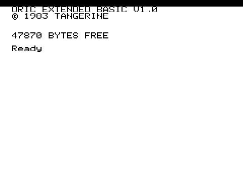
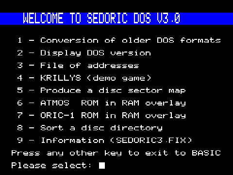
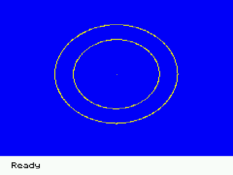

<h1 align="center">esp32oric</h1>

<p align="center">
  <b>An Oric Atmos or Oric-1 on a Makerfabs MaTouch ESP32-S3 7-inch touchscreen or an M5Stack Tab5.</b><br>
  A 1 MHz 6502A, BASIC 1.1 or 1.0, serial-attribute graphics, AY sound, cassette tapes and two Microdisc drives.
</p>

<p align="center">
  
  
  
  
  
</p>

<p align="center">
  
  
  <br><sub>Oric-1 BASIC and Sedoric 3, captured from the emulator running on the Tab5.</sub>
</p>

Choose **Atmos** or **Oric-1** in the touchscreen setup. Load BASIC programs
and games from TAP files on the microSD card, or switch on the Microdisc and
boot Sedoric or Oric DOS from a disk image. The shared
[esp32emu](https://github.com/rlucencic/esp32emu) runtime provides the 6502
core, display, touch, SD card, sound output, keyboards, Wi-Fi and web interface.

## Features

- **Machine** with a 6502A at 1 MHz, 64 KiB of RAM, a 6522 VIA and an
  AY-3-8912 for sound. Select BASIC 1.1 for the Atmos or BASIC 1.0 for the
  Oric-1. Localised BASIC 1.1 ROMs use their own keyboard layouts.
- **Display** with 40×28 text and 240×200 HIRES, eight colours, serial
  attributes, flashing, double-height text and 50/60 Hz display timing.
- **Tapes** with instant `CLOAD` and `CSAVE` in both BASIC versions.
  Real-time playback at 2400 or 300 baud feeds the VIA, including for
  games with their own tape loaders. Saves append to the mounted TAP.
- **Microdisc** with its own EPROM, a WD1793 controller and drives A: and
  B:. Mount writable MFM_DISK `.dsk` images or create blanks to format
  with Sedoric's `INIT`.
- **Keyboard and setup** with Bluetooth HID, USB HID on the Tab5, and the
  Tab5 Keyboard. Alt maps to FUNCT, Caps Lock sends CTRL-T, and F12 or
  Pause triggers the Oric's NMI. Hold the touchscreen's top-right corner
  for two seconds to return to setup.
- **Web interface** for uploading, mounting, creating and downloading media
  at `http://oric-atmos.local`. The status page shows memory, video, sound,
  keyboard, cassette and disk-controller state.

<p align="center">
  
  <br><sub>Atmos BASIC drawing in HIRES in the desktop build.</sub>
</p>

## Hardware

| | Makerfabs MaTouch ESP32-S3 7-inch | M5Stack Tab5 |
|---|---|---|
| Chip | ESP32-S3, 16 MB flash, 8 MB PSRAM | ESP32-P4, 16 MB flash, 32 MB PSRAM |
| Display | 1024×600 RGB touchscreen | 1280×720 MIPI-DSI touchscreen |
| Storage | microSD | microSD |
| Keyboard | Bluetooth HID | Bluetooth or USB HID, or the Tab5 Keyboard |
| Sound | MAX98357A speaker output | Built-in speaker |

## Getting started

### 1. What you need

ESP-IDF **5.5.6**, an `esp32emu` checkout beside this project, and a microSD
card for media. Supply the BASIC ROM for your chosen model and the Microdisc
EPROM if you want disk support. ROM filenames and checksums are in the
[ROM setup guide](roms/README.md).

### 2. Build and flash

Activate ESP-IDF and replace `PORT` with the board's serial port.

```sh
git clone https://github.com/rlucencic/esp32emu.git
git clone https://github.com/rlucencic/esp32oric.git
cd esp32oric

# Makerfabs MaTouch ESP32-S3
idf.py -B build -DIDF_TARGET=esp32s3 -DSDKCONFIG=build/sdkconfig -p PORT flash

# M5Stack Tab5
idf.py -B build-tab5 -DIDF_TARGET=esp32p4 -DSDKCONFIG=build-tab5/sdkconfig -p PORT flash
```

A full flash includes the local ROM files present in `roms/` at
configuration time. You can also put them in `oric/roms/` on the SD card,
where they take precedence over the flashed ROMs. Use one build target
at a time because they share the managed components directory.

### 3. First start

1. Put `.tap` and MFM_DISK `.dsk` files in `oric/` on the microSD card.
2. Pair a keyboard under **Bluetooth**, or connect one to the Tab5. Use
   **WiFi** to join the network for the web interface.
3. Choose **Atmos** or **Oric-1** under **Model**. Keep **Microdisc** off
   to go directly to BASIC when you tap **Start**.
4. To use a tape, mount it under **Media** or on the web page and enter
   `CLOAD""`. To boot a disk, mount a system disk in **A:** and enable
   **Microdisc**. Start or restart with the disk inserted.

## Development

```sh
make -C components/oric/host run
make -C components/oric/host check check-oric1
```

The desktop build uses the same machine core and writes a PPM screenshot.
The checks use the two BASIC ROMs and the Microdisc EPROM.
See the [hardware notes](docs/oric-hardware.md) for the memory map, tape
format, ULA timing and disk interface.

## Tested so far

- **Both boards** ran BASIC 1.0 and 1.1 at full speed. Onboard speaker
  recordings confirmed `PING`, `ZAP` and key clicks. The Tab5 was also tested
  with a Bluetooth keyboard.
- **Tapes and disks** were tested on both boards, including fast TAP
  save/load, 300-baud playback and Sedoric 3 boot and directory listing.
- **The desktop build** was used to check 349 original TAP files and 29
  MFM_DISK images. Of those, 211 tapes reached a title, menu or game
  and 22 disks booted. The [test notes](CLAUDE.md#testing) have more detail.

## Roadmap

See [TODO.md](TODO.md) for proposed work and how to verify it.

## Related emulators

| Project | Machines |
|---|---|
| [esp32ami](https://github.com/rlucencic/esp32ami) | Amiga 500, 2000, 600 and 1200 |
| [esp32arc](https://github.com/rlucencic/esp32arc) | Acorn Archimedes |
| [esp32cbm](https://github.com/rlucencic/esp32cbm) | Commodore 64 and 128 |
| [esp32coco](https://github.com/rlucencic/esp32coco) | Tandy Color Computer 2 and 3 |
| [esp32coupe](https://github.com/rlucencic/esp32coupe) | SAM Coupé |
| [esp32cpc](https://github.com/rlucencic/esp32cpc) | Amstrad CPC and CPC Plus |
| [esp32electron](https://github.com/rlucencic/esp32electron) | Acorn Electron |
| [esp32gs](https://github.com/rlucencic/esp32gs) | Apple IIGS |
| [esp32mac](https://github.com/rlucencic/esp32mac) | Macintosh Plus, SE and Classic |
| [esp32mac2](https://github.com/rlucencic/esp32mac2) | Macintosh LC and II |
| [esp32mac3](https://github.com/rlucencic/esp32mac3) | Macintosh LC II and LC III |
| [esp32msx](https://github.com/rlucencic/esp32msx) | MSX1 and MSX2 |
| [esp32pc](https://github.com/rlucencic/esp32pc) | IBM PC/XT and PC/AT |
| [esp32ql](https://github.com/rlucencic/esp32ql) | Sinclair QL |
| [esp32ste](https://github.com/rlucencic/esp32ste) | Atari STE |
| [esp32xl](https://github.com/rlucencic/esp32xl) | Atari 800XL and 130XE |
| [esp32zx](https://github.com/rlucencic/esp32zx) | ZX Spectrum 128K, +2 and +3 |

## Licence

[MIT](LICENSE) for the emulator source. Original ROMs and software are
supplied separately.
